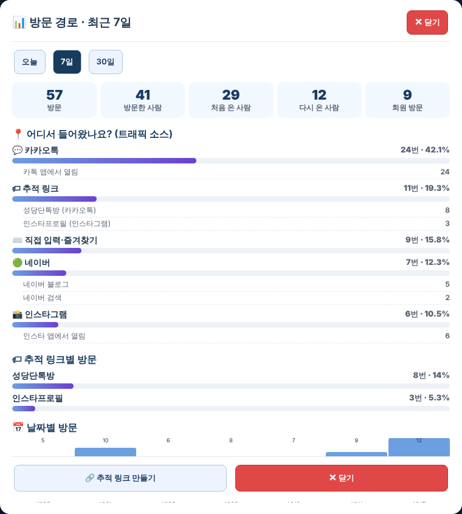
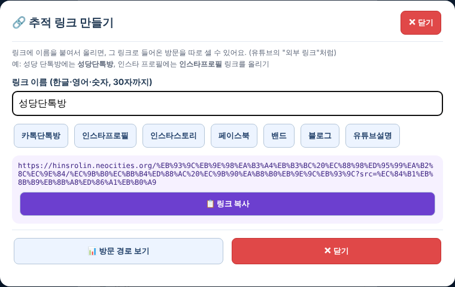

# 원기랜드 77차 — 유튜브처럼 자세한 방문 경로 통계 · 추적 링크

## 해야 할 일 2가지

### 1. 서버 코드 바꾸기

1. 받기: **[Code.gs(서버에 붙여넣기).txt](https://github.com/changdkand3-pixel/-/raw/claude/adoring-darwin-mewhr1/wonkiland-v77/Code.gs(%EC%84%9C%EB%B2%84%EC%97%90%20%EB%B6%99%EC%97%AC%EB%84%A3%EA%B8%B0).txt)**
2. **[10월 30일에 만든 "제목 없는 프로젝트"](https://script.google.com/d/1PQaf8fdRq8G838KeiqII1kHgTSn6NDYEbTqu-12xqnNfLAEneH2GAFUF/edit)** 를 엽니다.
3. **`Code.gs`** 내용을 모두 지우고 받은 내용을 붙여넣은 뒤 저장합니다. `CloudSync.gs`는 그대로 둡니다.
4. **배포 → 배포 관리 → 연필(수정) → 버전 "새 버전" → 배포**. ("새 배포"는 누르지 마세요.)

74차 코드에서 방문 기록 부분만 바꿨습니다. "방문기록" 시트에 **상세 경로 · 브라우저 · 운영체제 · 방문자** 열이 자동으로 더해집니다(예전 기록은 그대로).

### 2. HTML 올리기 (새 그림 없음 → HTML 하나만 올리면 됨)

**[웰컴투 원기랜드.html](https://github.com/changdkand3-pixel/-/raw/claude/adoring-darwin-mewhr1/wonkiland-v77/%EC%9B%B0%EC%BB%B4%ED%88%AC%20%EC%9B%90%EA%B8%B0%EB%9E%9C%EB%93%9C.html)** → `작업장`에서 먼저 시험한 뒤 **`드래곤볼 수학게임` 폴더**에 `웰컴투 원기랜드.html` 이름 그대로 덮어 올립니다.

그림까지 한 번에 받기: [wonkiland_v77_neocities.zip](https://github.com/changdkand3-pixel/-/raw/claude/adoring-darwin-mewhr1/wonkiland-v77/wonkiland_v77_neocities.zip).

**이번에 새로 생긴 그림 파일:** 없음

## 바뀐 점 (76차 → 77차)

🔒 관리자 메뉴 → 👀 최근 방문한 회원 아래 **📊 방문 경로 자세히 보기**

1. **기간:** 오늘 · 7일 · 30일
2. **요약:** 방문 수 · 방문한 사람 수 · 처음 온 사람 · 다시 온 사람 · 회원 방문
3. **📍 어디서 들어왔나요? (트래픽 소스)**: 들어온 곳별 막대와 %, 그 아래 상세 경로
   - 카카오톡(카톡 앱에서 열림) · 인스타그램 · 페이스북 · 밴드 (앱 안에서 열린 것으로 구분)
   - 네이버 검색 / 네이버 블로그 / 네이버 카페 · 다음 검색 / 다음 카페 · 구글 검색 · 유튜브 · X(트위터) · 스레드
   - 그 밖의 사이트는 사이트 주소로 보여 줍니다.
4. **🏷 추적 링크별 방문**
5. **📅 날짜별 · 🕐 시간대별 방문**
6. **📱 기기 · 🌐 브라우저·앱 · 💻 운영체제**
7. **🔗 추적 링크 만들기**: 링크에 이름을 붙입니다(예: `성당단톡방`, `인스타프로필`). 단톡방·프로필마다 다른 링크를 올리면 어디서 들어왔는지 정확히 셀 수 있습니다(유튜브의 "외부 링크"처럼). 📋 복사 버튼이 있습니다.
8. 지도 도구의 **💬 원기랜드 카톡·링크 공유** 버튼으로 보낸 링크는 "추적 링크 › 공유버튼"으로 따로 셉니다.
9. 77차 업데이트 안내 카드 (방문자에게는 쉬운 말 안내만 보입니다).

**알아 두실 점:** 문자, 메모 앱, 주소 직접 입력, 즐겨찾기로 들어오면 브라우저가 어디서 왔는지 알려 주지 않아 **"직접 입력·즐겨찾기"** 로 셉니다. 이런 곳에 올릴 때도 추적 링크를 쓰면 정확히 알 수 있습니다.

