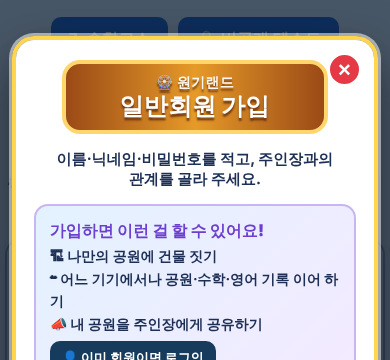

# 원기랜드 87차 — 일반회원 가입 화면 제목 글자 정리

## 올리는 방법 (HTML 하나만 올리면 됨)

**[웰컴투 원기랜드.html](https://github.com/changdkand3-pixel/-/raw/claude/adoring-darwin-mewhr1/wonkiland-v87/%EC%9B%B0%EC%BB%B4%ED%88%AC%20%EC%9B%90%EA%B8%B0%EB%9E%9C%EB%93%9C.html)** → **`드래곤볼 수학게임` 폴더**에 `웰컴투 원기랜드.html` 이름 그대로 덮어 올립니다.

그림까지 한 번에 받기: [wonkiland_v87_neocities.zip](https://github.com/changdkand3-pixel/-/raw/claude/adoring-darwin-mewhr1/wonkiland-v87/wonkiland_v87_neocities.zip). **이번에 새로 생긴 그림 파일:** 없음 · **서버 코드:** 바꿀 것 없음

## 바뀐 점 (86차 → 87차)

1. 가입 화면 제목이 "원기랜드 일반회 / 원 가입"처럼 어색하게 끊기던 것을 **"🎡 원기랜드" (작게) / "일반회원 가입" (크게)** 두 줄로 정해서 나눴습니다.
2. 화면 크기(휴대폰·컴퓨터)에 맞춰 제목 글자 크기를 조정했습니다. 한국어 낱말 중간에서 줄이 바뀌지 않게 했습니다.
3. 컴퓨터에 따라 반창고처럼 보이던 🎟 표시를 어디서나 표처럼 보이는 **🎫**로 바꿨습니다(가입 버튼·안내창·게시판).
4. "가입하면 할 수 있어요"의 ☁ 표시를 또렷한 ☁️로 바꿨습니다.
5. 87차 업데이트 안내 카드.

