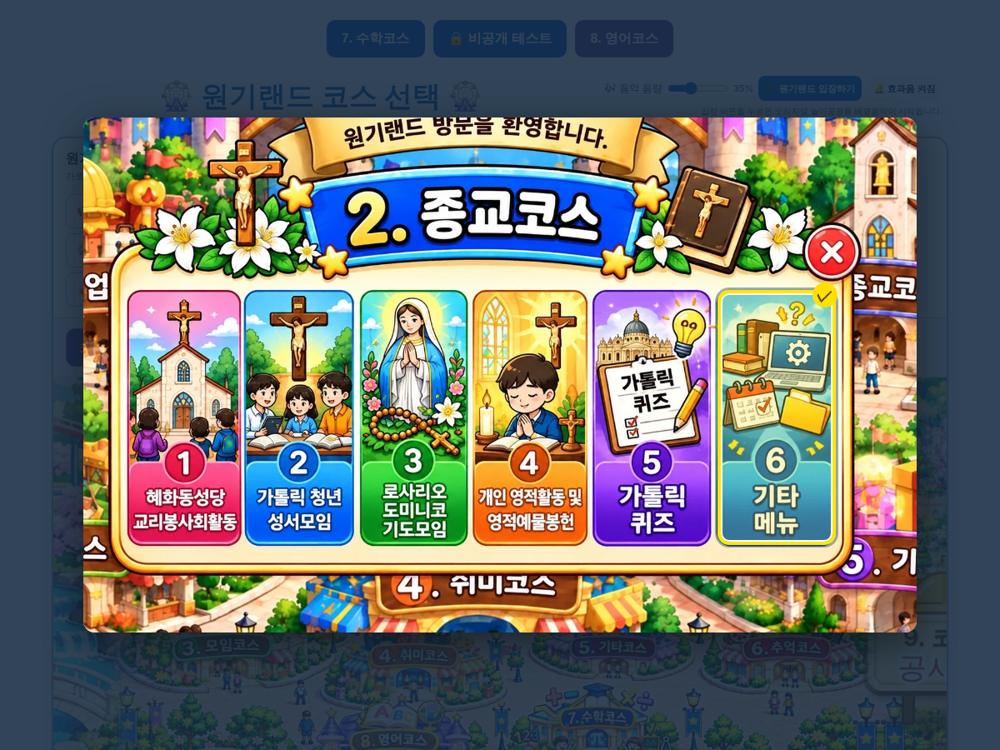

# 원기랜드 90차 — 2번 종교코스 메뉴 새 그림 (6가지)

## 올리는 방법 (파일 2개)

1. **새 그림 1개 → `작업장` 폴더**
   - **[8bce1d31155fb2.webp](https://github.com/changdkand3-pixel/-/raw/claude/adoring-darwin-mewhr1/wonkiland-v90/8bce1d31155fb2.webp)** (새 종교코스 메뉴 그림, 약 317KB)를 받아 Neocities **`작업장` 폴더**에 이름 그대로 올립니다.
2. **HTML → `드래곤볼 수학게임` 폴더**
   - **[웰컴투 원기랜드.html](https://github.com/changdkand3-pixel/-/raw/claude/adoring-darwin-mewhr1/wonkiland-v90/%EC%9B%B0%EC%BB%B4%ED%88%AC%20%EC%9B%90%EA%B8%B0%EB%9E%9C%EB%93%9C.html)** 을 `웰컴투 원기랜드.html` 이름 그대로 덮어 올립니다.

그림까지 한 번에 받기: [wonkiland_v90_neocities.zip](https://github.com/changdkand3-pixel/-/raw/claude/adoring-darwin-mewhr1/wonkiland-v90/wonkiland_v90_neocities.zip). **서버 코드:** 바꿀 것 없음

**이번에 새로 생긴 그림 파일 (작업장에 올릴 것):**
- `8bce1d31155fb2.webp` — 2번 종교코스 메뉴

(나머지 416개 그림은 이미 작업장에 있습니다.)

## 바뀐 점 (89차 → 90차)

1. 2번 종교코스 메뉴를 **보내 주신 새 그림**으로 바꿨습니다.
   - ① 혜화동성당 교리봉사회활동
   - ② 가톨릭 청년 성서모임
   - ③ 로사리오 도미니코 기도모임
   - ④ 개인 영적활동 및 영적예물봉헌
   - ⑤ **가톨릭 퀴즈 (새로 추가)**
   - ⑥ 기타 메뉴
2. 누르는 칸 6개를 새 그림의 카드 위치에 맞췄습니다. 누르면 노란 테두리와 ✓로 표시됩니다.
3. 새 그림 오른쪽 위에 그려진 **빨간 ✕를 누르면 닫힙니다**(따로 겹쳐 보이던 닫기 버튼 없앰).
4. 결과 글자의 "해화동성당"을 그림과 같은 **"혜화동성당"**으로 바로잡았습니다.
5. 90차 업데이트 안내 카드.

