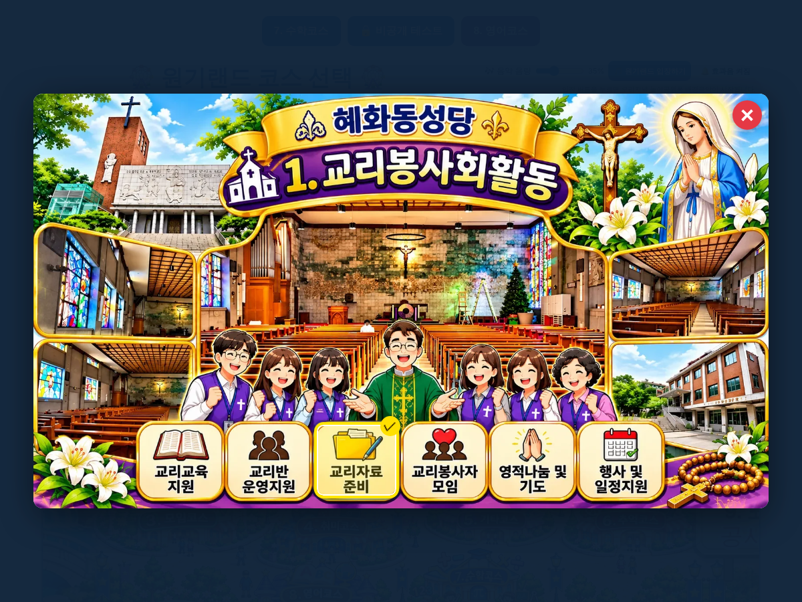

# 원기랜드 91차 — 혜화동성당 교리봉사회활동 세부 메뉴

## 올리는 방법 (파일 2개)

1. **새 그림 1개 → `작업장` 폴더**
   - **[5c43f7b9324f50.webp](https://github.com/changdkand3-pixel/-/raw/claude/adoring-darwin-mewhr1/wonkiland-v91/5c43f7b9324f50.webp)** (혜화동성당 교리봉사회활동 그림, 약 409KB)를 Neocities **`작업장` 폴더**에 이름 그대로 올립니다.
   - 90차 종교코스 그림 **`8bce1d31155fb2.webp`** 를 아직 안 올리셨다면 그것도 함께 올려 주세요([받기](https://github.com/changdkand3-pixel/-/raw/claude/adoring-darwin-mewhr1/wonkiland-v91/8bce1d31155fb2.webp)).
2. **HTML → `드래곤볼 수학게임` 폴더**
   - **[웰컴투 원기랜드.html](https://github.com/changdkand3-pixel/-/raw/claude/adoring-darwin-mewhr1/wonkiland-v91/%EC%9B%B0%EC%BB%B4%ED%88%AC%20%EC%9B%90%EA%B8%B0%EB%9E%9C%EB%93%9C.html)** 을 이름 그대로 덮어 올립니다.

그림까지 한 번에 받기: [wonkiland_v91_neocities.zip](https://github.com/changdkand3-pixel/-/raw/claude/adoring-darwin-mewhr1/wonkiland-v91/wonkiland_v91_neocities.zip). **서버 코드:** 바꿀 것 없음

**이번에 새로 생긴 그림 파일 (작업장에 올릴 것):**
- `5c43f7b9324f50.webp` — 혜화동성당 1. 교리봉사회활동

## 바뀐 점 (90차 → 91차)

1. 2번 종교코스에서 **① 혜화동성당 교리봉사회활동**을 누르면 보내 주신 **교리봉사회활동 그림 창**이 열립니다.
2. 아래 6가지 중에서 고를 수 있습니다(누르면 노란 테두리·✓).
   - 교리교육 지원 · 교리반 운영지원 · 교리자료 준비
   - 교리봉사자 모임 · 영적나눔 및 기도 · 행사 및 일정지원
3. 결과에 고른 세부 항목까지 나옵니다.
   ```
   2. 종교코스
   └ 혜화동성당 교리봉사·사회활동
      └ 교리자료 준비
   ```
4. 오른쪽 위 ✕, 바깥 누르기, Esc로 닫으면 종교코스 창으로 돌아갑니다. 종교코스에서 다른 칸을 고르면 세부 선택은 지워집니다.
5. 91차 업데이트 안내 카드.


