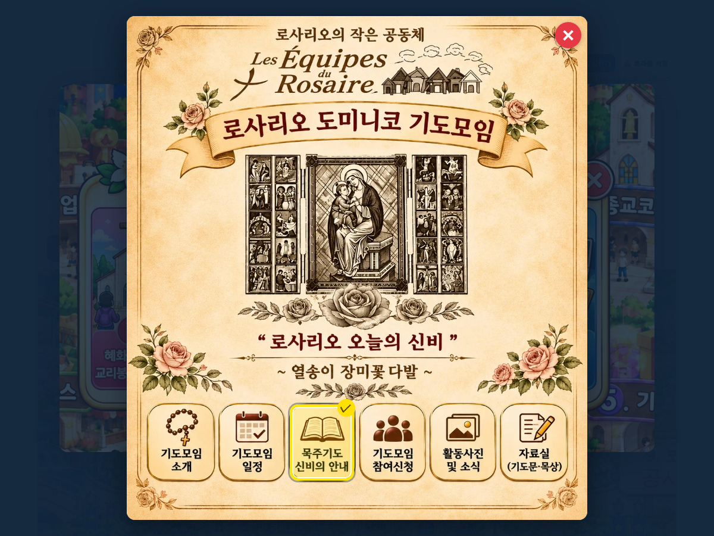

# 원기랜드 93차 — 로사리오 도미니코 기도모임 세부 메뉴

## 올리는 방법 (파일 2개)

1. **새 그림 1개 → `작업장` 폴더**
   - **[e30f8ebad0b456.webp](https://github.com/changdkand3-pixel/-/raw/claude/adoring-darwin-mewhr1/wonkiland-v93/e30f8ebad0b456.webp)** (로사리오 도미니코 기도모임 그림, 약 284KB)를 Neocities **`작업장` 폴더**에 이름 그대로 올립니다.
   - 90~92차 그림(`8bce1d31155fb2.webp`, `5c43f7b9324f50.webp`, `f61527fd03e5db.webp`)을 아직 안 올리셨다면 함께 올려 주세요(zip 안에 다 들어 있습니다).
2. **HTML → `드래곤볼 수학게임` 폴더**
   - **[웰컴투 원기랜드.html](https://github.com/changdkand3-pixel/-/raw/claude/adoring-darwin-mewhr1/wonkiland-v93/%EC%9B%B0%EC%BB%B4%ED%88%AC%20%EC%9B%90%EA%B8%B0%EB%9E%9C%EB%93%9C.html)** 을 이름 그대로 덮어 올립니다.

그림까지 한 번에 받기: [wonkiland_v93_neocities.zip](https://github.com/changdkand3-pixel/-/raw/claude/adoring-darwin-mewhr1/wonkiland-v93/wonkiland_v93_neocities.zip). **서버 코드:** 바꿀 것 없음

**이번에 새로 생긴 그림 파일 (작업장에 올릴 것):**
- `e30f8ebad0b456.webp` — 로사리오 도미니코 기도모임

## 바뀐 점 (92차 → 93차)

1. 2번 종교코스에서 **③ 로사리오 도미니코 기도모임**을 누르면 보내 주신 **기도모임 그림 창**이 열립니다. 세로 그림이라 화면 높이에 맞춰 보입니다.
2. 아래 6가지 중에서 고를 수 있습니다(누르면 노란 테두리·✓).
   - 기도모임 소개 · 기도모임 일정 · 묵주기도 신비의 안내
   - 기도모임 참여신청 · 활동사진 및 소식 · 자료실(기도문·묵상)
3. 결과에 고른 세부 항목까지 나옵니다.
   ```
   2. 종교코스
   └ 로사리오 도미니코 기도모임
      └ 묵주기도 신비의 안내
   ```
4. 오른쪽 위 ✕, 바깥 누르기, Esc로 닫으면 종교코스 창으로 돌아갑니다.
5. 93차 업데이트 안내 카드.


