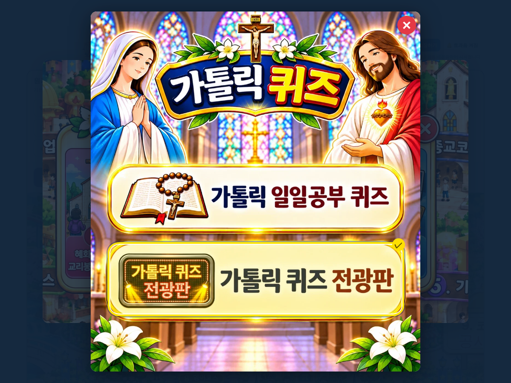

# 원기랜드 95차 — 가톨릭 퀴즈 세부 메뉴

## 올리는 방법 (파일 2개)

1. **새 그림 1개 → `작업장` 폴더**
   - **[283f8403963323.webp](https://github.com/changdkand3-pixel/-/raw/claude/adoring-darwin-mewhr1/wonkiland-v95/283f8403963323.webp)** (가톨릭 퀴즈 그림, 약 248KB)를 Neocities **`작업장` 폴더**에 이름 그대로 올립니다.
   - 90~94차 그림(`8bce1d31155fb2.webp`, `5c43f7b9324f50.webp`, `f61527fd03e5db.webp`, `e30f8ebad0b456.webp`, `b8e7e25fe101f0.webp`)을 아직 안 올리셨다면 함께 올려 주세요(zip 안에 다 들어 있습니다).
2. **HTML → `드래곤볼 수학게임` 폴더**
   - **[웰컴투 원기랜드.html](https://github.com/changdkand3-pixel/-/raw/claude/adoring-darwin-mewhr1/wonkiland-v95/%EC%9B%B0%EC%BB%B4%ED%88%AC%20%EC%9B%90%EA%B8%B0%EB%9E%9C%EB%93%9C.html)** 을 이름 그대로 덮어 올립니다.

그림까지 한 번에 받기: [wonkiland_v95_neocities.zip](https://github.com/changdkand3-pixel/-/raw/claude/adoring-darwin-mewhr1/wonkiland-v95/wonkiland_v95_neocities.zip). **서버 코드:** 바꿀 것 없음

**이번에 새로 생긴 그림 파일 (작업장에 올릴 것):**
- `283f8403963323.webp` — 가톨릭 퀴즈

## 바뀐 점 (94차 → 95차)

1. 2번 종교코스에서 **⑤ 가톨릭 퀴즈**를 누르면 보내 주신 가톨릭 퀴즈 그림 창이 열립니다.
2. 2가지 중에서 고를 수 있습니다(누르면 노란 테두리·✓): **가톨릭 일일공부 퀴즈 · 가톨릭 퀴즈 전광판**
3. 결과에 고른 세부 항목까지 나옵니다(예: `└ 가톨릭 퀴즈 전광판`).
4. ✕, 바깥 누르기, Esc로 닫으면 종교코스 창으로 돌아갑니다.
5. 95차 업데이트 안내 카드.

